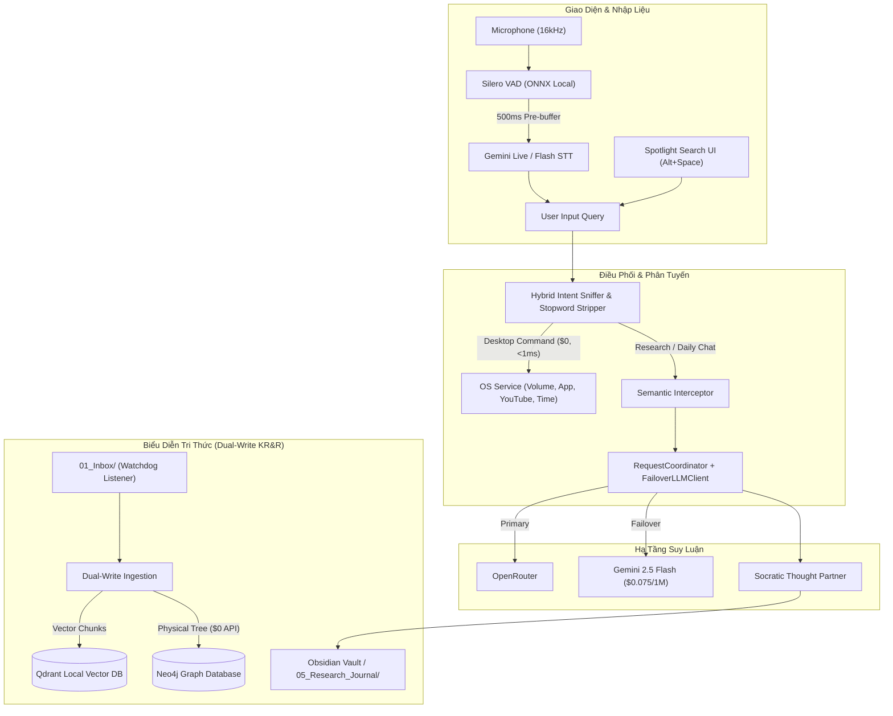

# Digital Scholar (Personal Research Cockpit V6.0)

## 1. Project Overview

**Digital Scholar** là một trợ lý cá nhân và đối tác nghiên cứu học thuật chạy nền (Background Daemon) dành riêng cho hệ điều hành **Windows 10/11**. Dự án kết hợp hài hòa hai nhu cầu thiết yếu:
1. **Desktop Personal Assistant:** Thao tác máy tính mượt mà (YouTube, Volume, App, Ghi chú, Spotlight) với độ trễ dưới 1ms, chi phí $0 API và tương tác giọng nói hoàn toàn rảnh tay (Hands-free).
2. **Socratic Research Cockpit:** Không chỉ tóm tắt tài liệu thụ động mà đóng vai trò đối tác tư duy phản biện học thuật (Socratic Thought Partner), hỗ trợ bóc tách các giả định ngầm (implicit assumptions) và phát hiện điểm nghẽn (bottlenecks) giữa các công trình nghiên cứu.

**Why Digital Scholar?**
- *Traditional desktop search* ➔ Lexical Search ➔ No reasoning ➔ No academic context
- *Standard Chatbot* ➔ Thụ động hỏi gì đáp nấy ➔ Ảo giác khi thiếu liên kết đồ thị
- *Digital Scholar* ➔ Dual-Write KR&R ➔ Silero VAD Voice ➔ Socratic Thought Partner

---

## 2. Key Capabilities

- ✔ **Hands-free Voice Interface:** Tích hợp **Silero VAD (ONNX)** chạy local CPU (<2MB), hỗ trợ Pre-speech Ring Buffer (500ms) và Trailing Silence (1.5s) để thoại rảnh tay tự động không cần bấm phím.
- ✔ **Hybrid Intent Sniffer & Vietnamese Stopword Stripper:** Bóc tách chính xác câu lệnh văn nói lộn xộn, lọc sạch 100% từ đệm rác để điều khiển YouTube, Âm lượng, Ứng dụng ở tầng 0 ($0 API, <1ms).
- ✔ **Dual-Write Architecture (Qdrant + Neo4j):** Đồng bộ song song vector chunks vào Qdrant và cây cấu trúc tài liệu (`:Paper -> :Section -> :Chunk`) vào Neo4j với $0 API, bẻ gãy hoàn toàn "Bẫy tái chỉ mục" (Re-indexing Trap).
- ✔ **Failover LLM Client & Cost Guard:** Tự động chuyển vùng dự phòng từ OpenRouter sang Gemini Direct (`gemini-2.5-flash`) khi gặp lỗi hạn ngạch HTTP 402/403/429, duy trì chi phí hoạt động chỉ từ $1 - $3/tháng.
- ✔ **Socratic Thought Partner & Obsidian Research Journal:** Tự động chêm gợi ý phản biện Socratic khi tra cứu nghiên cứu và lưu trữ Research Gaps vào `Obsidian_Vault/05_Research_Journal/YYYY-MM-DD.md`.
- ✔ **AST-based Architecture Police:** Kiểm tra tuân thủ Clean Architecture tự động bằng Abstract Syntax Tree qua `production_check.py`.

---

## 3. Quick Start

**Yêu cầu hệ thống:** Windows 10/11 (64-bit), Python 3.11.x, 8GB RAM.

```bash
# 1. Clone repository
git clone <repo_url>
cd agent_nckh

# 2. Tạo môi trường ảo và kích hoạt
python -m venv venv
venv\Scripts\activate

# 3. Cài đặt dependencies
pip install -r requirements.txt

# 4. Kiểm tra cấu hình .env
# Điền GEMINI_API_KEY, OPENROUTER_API_KEY, NEO4J_URI...

# 5. Chạy kiểm tra tĩnh và kiểm thử hệ thống
python production_check.py

# 6. Khởi động hệ thống (Chạy quyền Administrator để bắt hotkey)
python main.py
```

---

## 4. System Architecture

Hệ thống tuân thủ **Clean Architecture** đa tầng:



---

## 5. Technology Stack

| Layer | Technology | Vai trò |
|---|---|---|
| **UI** | PyQt6 | Spotlight Search Window, System Tray, Global Hotkey |
| **Voice VAD** | Silero VAD v6 (ONNX Runtime) | Voice Activity Detection local CPU, Pre-buffer 500ms |
| **STT Voice** | Gemini 3.1 Flash Live / 2.5 Flash | Nhận diện giọng nói tiếng Việt in-memory PCM |
| **Routing** | HybridIntentSniffer + SemanticInterceptor | Regex Co-occurrence, Stopword Stripper, e5-base anchors |
| **LLM Inference** | FailoverLLMClient (OpenRouter + Gemini Direct) | Suy luận tự động chuyển vùng, chống lỗi 403 quota |
| **Vector DB** | Qdrant Local | Lưu trữ dense vectors & micro-chunks |
| **Graph DB** | Neo4j Aura Cloud / Local | Cây cấu trúc tài liệu (`:Paper -> :Section -> :Chunk`) |
| **Knowledge Vault** | Obsidian Markdown Vault | Lưu trữ ghi chú dài hạn & Research Journal |
| **Linter / Police** | AST Custom Rules (Tier A, B, C) | Tự động bảo vệ Clean Architecture |

---

## 6. Testing & Quality Assurance

Hệ thống được bảo vệ bởi bộ kiểm thử 2 pha toàn diện:

- **Phase 1: Static Analysis (`production_check.py`)**: Quét AST toàn bộ mã nguồn `src/` và `main.py` để đảm bảo 0 vi phạm Tier A (không có bare except, thuần router, không vi phạm chiều phụ thuộc).
- **Phase 2: Dynamic Tests (`run_tests.py` & `tests/`)**:
  - `run_tests.py`: 51/51 integration tests vượt qua (Memory, Interceptor, Orchestrator, Qdrant, Parser, Watchdog, UI, Pipeline).
  - `tests/`: 20/20 unit tests vượt qua (Intent Sniffer, Silero VAD, Research Journal, Tier AST Rules).
  - **Tổng cộng: 71/71 tests (100% Pass Rate).**

---

## 7. Repository Structure

```text
agent_nckh/
├── main.py                     (Composition Root & Application Entry)
├── production_check.py         (AST Architecture Police & Static Analysis)
├── run_tests.py                (Integration Test Runner - 51 tests)
├── tests/                      (Unit Test Suites - 20 tests)
│   ├── test_intent_sniffer.py  (Lọc từ đệm văn nói & Desktop routing)
│   ├── test_silero_vad.py      (Silero VAD ONNX detection)
│   ├── test_research_journal.py(Obsidian Gap recording & Socratic prompt)
│   └── test_tier_*.py          (Architecture Linter Rules)
├── src/
│   ├── core/                   (Application Layer)
│   │   ├── coordinator.py      (Request Coordinator & Socratic injection)
│   │   ├── intent_sniffer.py   (Hybrid Intent Sniffer & Stopword Stripper)
│   │   ├── orchestrator.py     (ReAct state machine & Self-critique)
│   │   └── semantic_interceptor.py
│   ├── infrastructure/         (Infrastructure Layer)
│   │   ├── failover_client.py  (Auto-Failover LLM Client)
│   │   ├── gemini_client.py    (Gemini Direct SDK Adapter)
│   │   └── openrouter_client.py
│   ├── db/                     (Database Layer)
│   │   ├── hybrid_rag.py       (Dual-Write Qdrant & Neo4j Physical Tree)
│   │   └── reranker.py         (Voyage AI Reranker)
│   ├── services/               (Services Layer)
│   │   ├── research_journal.py (Obsidian Research Journaling)
│   │   ├── docx_exporter.py    (Xuất báo cáo Word)
│   │   └── daily/              (OS, Media, Workspace controllers)
│   ├── ui/                     (Presentation Layer)
│   │   ├── spotlight.py        (Spotlight Search UI)
│   │   ├── silero_vad.py       (Silero VAD ONNX Engine)
│   │   └── voice_engine.py     (Voice Recorder & Gemini Live STT)
│   ├── utils/                  (Parsing & Watchdog Layer)
│   │   ├── parser.py           (C5 Prefix & Heading-aware PDF/PPTX Parser)
│   │   └── watchdog_listener.py(Giám sát 01_Inbox/ & Auto Dual-Write)
│   └── shared/                 (Foundation Layer: Config, Settings, Metrics)
├── Obsidian_Vault/             (Personal Knowledge Vault)
│   ├── 01_Inbox/               (Thư mục thả tài liệu mới)
│   ├── 02_Knowledge/           (Kho tài liệu đã xử lý)
│   ├── 03_Agent_Memory/        (Hồ sơ cá nhân & Trí nhớ dài hạn)
│   └── 05_Research_Journal/    (Nhật ký lỗ hổng nghiên cứu YYYY-MM-DD.md)
└── docs/                       (Tài liệu kiến trúc, ADRs, Roadmaps)
```
