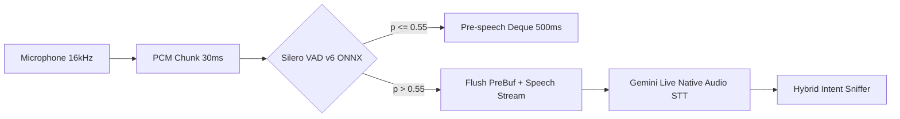
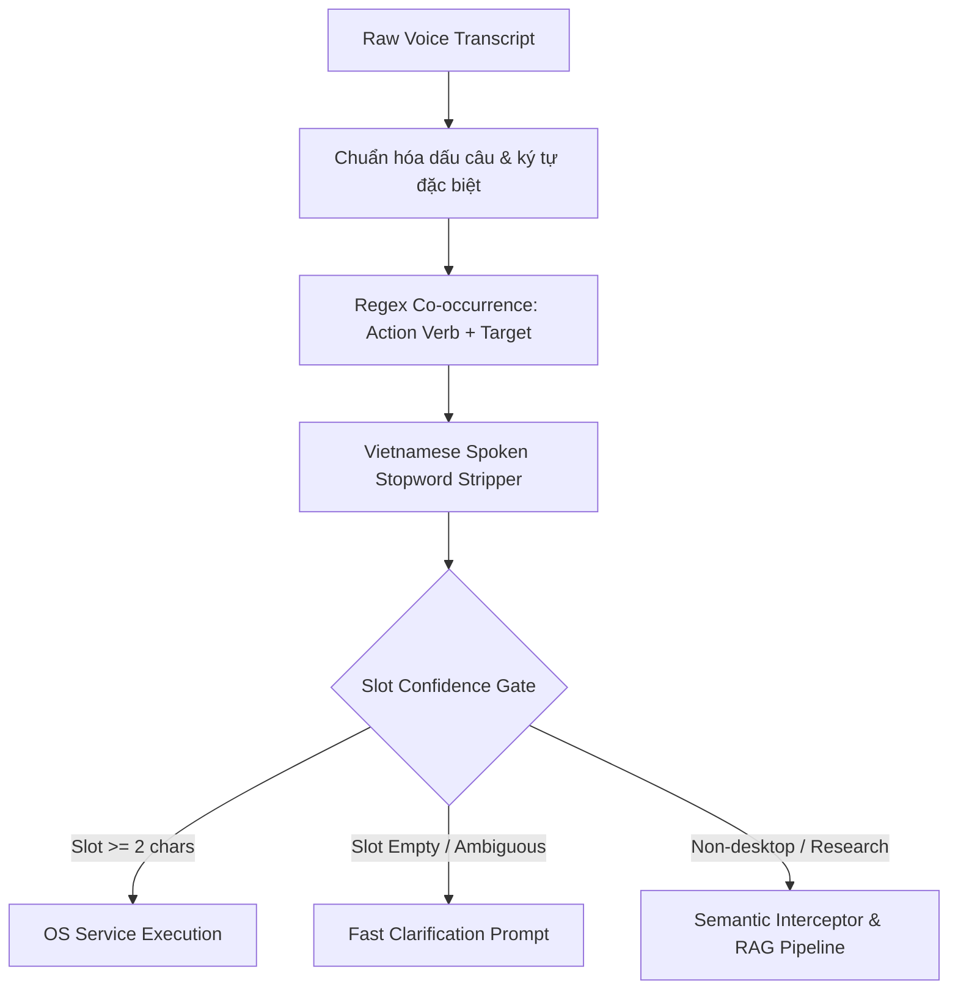

# Processing Pipelines Details

Tài liệu này quy định các thông số kỹ thuật nội bộ (Implementation Details) của các luồng xử lý chính trong Digital Scholar (Personal Research Cockpit V6.0).

---

## 1. C5 HEADING-AWARE & PARENT-CHILD CHUNKING

Kế thừa phương pháp luận từ dự án NCKH, luồng bóc tách PDF thực hiện:
- **Heading Detection:** Sử dụng PyMuPDF đọc font size của từng span văn bản. Nếu `font_size > median * 1.2` hoặc `is_bold`, đoạn văn được nhận diện là Tiêu đề mục (Section Heading).
- **C5 Prefix Context Injection:** Mỗi micro-chunk được gắn tiền tố cấu trúc:
  `[Tên bài báo | Section: Methodology | Trang: N]`
- **Parent-Child Hierarchy:**
  - *Parent chunk:* Đại diện cho toàn bộ trang hoặc section lớn (~600 ký tự), mang UUID định danh `parent_id`.
  - *Child chunk:* Các đoạn văn nhỏ (150 - 300 ký tự) tối ưu cho việc sinh vector đặc trưng cao, mang thuộc tính tham chiếu `parent_id`.
  - *Retrieval Rule:* Tìm kiếm vector trên Child chunk $\rightarrow$ khi sinh câu trả lời thì nạp nội dung của Parent chunk để bảo toàn đầy đủ ngữ cảnh.

---

## 2. HANDS-FREE VOICE PIPELINE (SILERO VAD + GEMINI LIVE STT)

Luồng xử lý âm thanh không lưu file tạm trên ổ cứng (In-memory PCM16, 16000Hz, Mono):

- **Silero VAD v6:** File mô hình ONNX (<2MB) chạy trên CPU qua `onnxruntime`, chu kỳ xử lý 576 samples (36ms).
- **Pre-speech Ring Buffer:** Luôn lưu giữ 500ms audio trong `collections.deque(maxlen=16)`. Khi phát hiện tiếng nói, giải phóng toàn bộ 500ms này vào đầu luồng để bảo toàn phụ âm đầu câu.
- **Trailing Silence:** Đếm số frame im lặng liên tiếp. Sau 1.5 giây im lặng, tự động đóng gói buffer gửi sang STT mà không cần người dùng thao tác bàn phím.

---

## 3. HYBRID INTENT SNIFFER & VIETNAMESE STOPWORD STRIPPER

Tầng phân tuyến nhanh ($0 API, <1ms) xử lý văn nói đời thường:

- **Từ điển hư từ lọc sạch:** `ờ, à, ừm, giùm, hộ, tao, anh, em, cho, cái, tí, coi, xem, nghe, bài gì của, ấy, đó, này...`
- **Ví dụ thực nghiệm:**
  - Input: *"Ờ... mở giùm tao cái... bài gì của Sơn Tùng ấy trên YouTube đi"*
  - Output: `Intent=OS_YOUTUBE`, `Slot='Sơn Tùng'`, `Action=youtube_search`.

---

## 4. DUAL-WRITE INGESTION PIPELINE (QDRANT + NEO4J)

Giải quyết dứt điểm Bẫy tái chỉ mục (Re-indexing Trap) khi lưu trữ tài liệu dài hạn:

- **Bước 1 (Qdrant Vector Storage):**
  - Chunks được đẩy vào `QdrantManager.upsert_chunks()` $\rightarrow$ Trả về danh sách `chunk_id` (UUIDv4).
- **Bước 2 (Neo4j Physical Tree Dual-Write - $0 API):**
  - Tự động dựng cây cấu trúc hình thức:
    - Node `:Paper {name: source, total_chunks: N}`
    - Node `:Section {name: paper::section_title}`
    - Node `:Chunk {name: chunk_id, qdrant_id: chunk_id, preview: text[:120]}`
    - Quan hệ: `(:Paper)-[:HAS_SECTION]->(:Section)-[:HAS_CHUNK]->(:Chunk)`
- **Bước 3 (Backfill Ready):**
  - Vì mỗi node Neo4j đã lưu `qdrant_id`, khi cần trích xuất Semantic Graph ở Phase 4, hệ thống đọc trực tiếp text từ Qdrant mà không cần parse lại file PDF gốc.

---

## 5. SOCRATIC THOUGHT PARTNER & OBSERVED RESEARCH JOURNAL

- **Kênh ngầm (Asynchronous):**
  - Khi phát hiện lỗ hổng nghiên cứu hoặc mâu thuẫn giả định giữa các công trình, hệ thống âm thầm ghi chép vào `Obsidian_Vault/05_Research_Journal/YYYY-MM-DD.md`.
- **Kênh nổi (Just-in-Time):**
  - Khi người dùng hỏi đáp về phương pháp, thuật toán trong Spotlight UI, `RequestCoordinator` tự động bổ sung câu hỏi phản biện:
    > *"💡 Gợi ý phản biện học thuật: Phương pháp trên có phụ thuộc vào giả định ngầm nào không? Điểm nghẽn lớn nhất khi áp dụng vào thực tế là gì?"*
